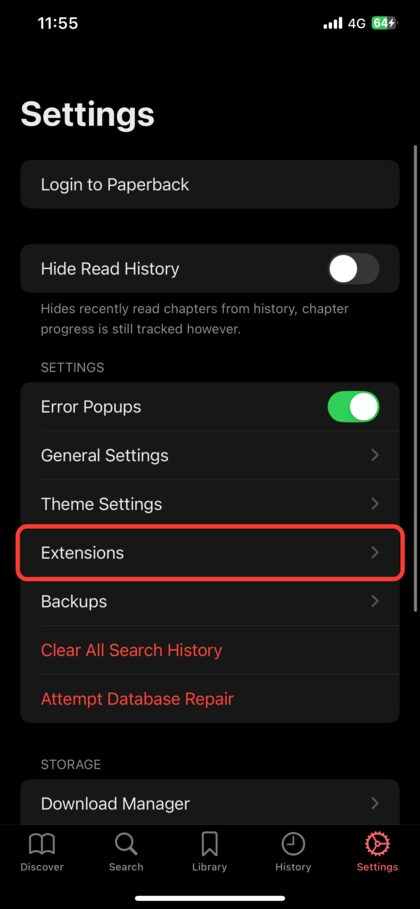
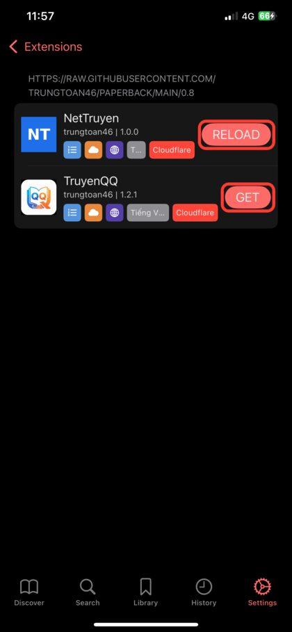
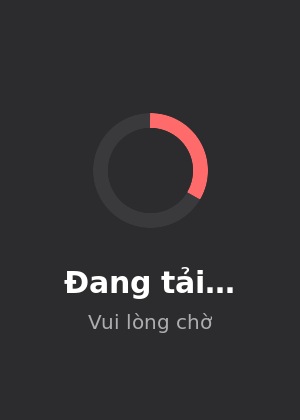
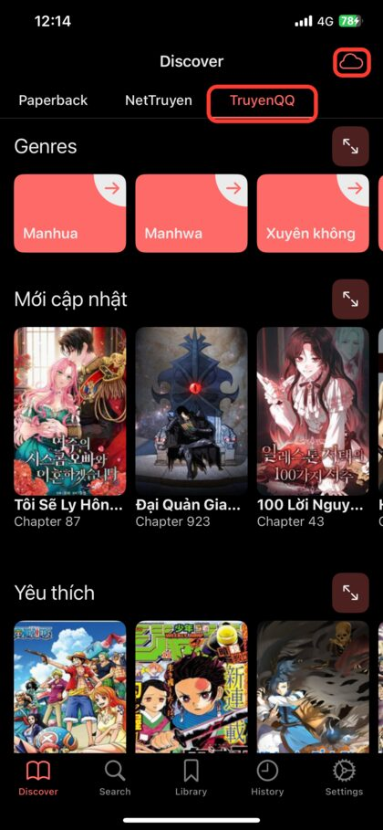
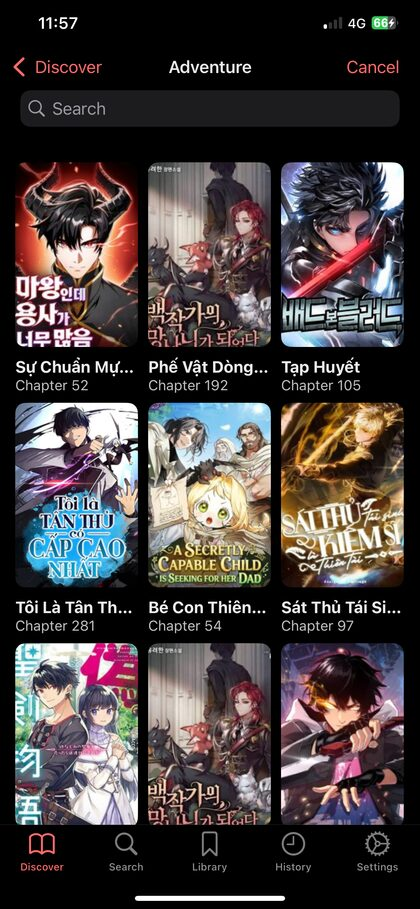
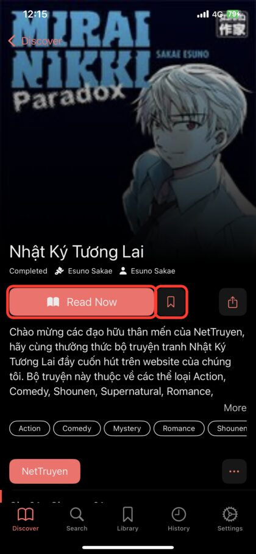
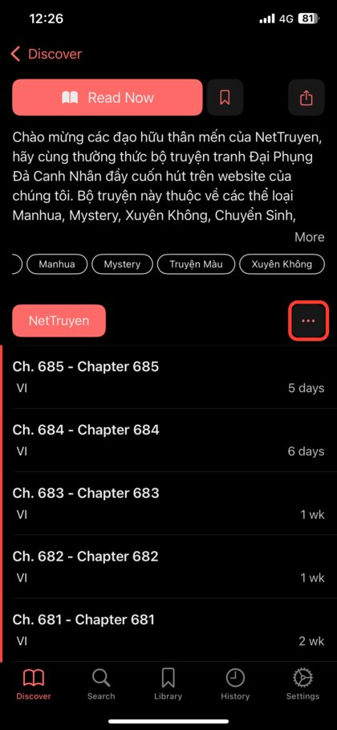

<h1 align="center">Truyện tranh tiếng Việt cho Paperback</h1>

<p align="center">
  &nbsp;
  &nbsp;
  
</p>

<p align="center">
  Bộ nguồn (extension) giúp app <b>Paperback</b> trên iPhone/iPad đọc truyện từ các web truyện tranh tiếng Việt:<br>
  xem truyện mới, tìm kiếm, lọc theo thể loại, đọc chương và lưu vào thư viện.
</p>

## Nguồn hiện có

| | Nguồn | Trang web | Phiên bản |
|:---:|---|---|:---:|
|  | **TruyenQQ** | truyenqqko.com | 1.3.6 |
|  | **NetTruyen** | nettruyen.gg | 1.1.5 |
|  | **Góc Truyện Tranh Vui** | goctruyentranhvui31.com | 1.0.2 |

> [!NOTE]
> Cần app **Paperback 0.8** (đã thử trên 0.8.11). Paperback chỉ có trên **iPhone/iPad**, không dùng được trên Android.

**Mục lục:** [Cài đặt](#1-cài-đặt) · [Cách dùng](#2-cách-dùng) · [Cài đặt của nguồn](#3-cài-đặt-của-nguồn) · [Cập nhật](#4-cập-nhật) · [Gặp lỗi?](#5-gặp-lỗi) · [Dành cho nhà phát triển](#6-dành-cho-nhà-phát-triển)

---

## 1. Cài đặt

1. Mở Paperback, vào **Settings → Extensions**.
2. Bấm **Edit** (góc trên bên phải), rồi bấm **+** (góc trên bên trái). Dán địa chỉ sau và lưu:

   ```
   https://raw.githubusercontent.com/trungtoan46/paperback/main/0.8
   ```

3. Mở repo vừa thêm trong **Extensions**, bấm **GET** ở nguồn bạn muốn dùng.
4. Xong! Vào tab **Discover**, mỗi nguồn là một tab ở phía trên.

<table>
  <tr>
    <td align="center" width="50%">
      <br>
      <b>Bước 1:</b> Settings → <b>Extensions</b>
    </td>
    <td align="center" width="50%">
      <br>
      <b>Bước 3:</b> bấm <b>GET</b> để cài<br>(nguồn đã cài hiện <b>RELOAD</b>)
    </td>
  </tr>
</table>

> [!TIP]
> **Cách thêm repo nhanh:** copy dòng dưới, dán vào **thanh địa chỉ Safari**, bấm **Đi** rồi chọn **Mở** bằng Paperback.
>
> ```
> paperback://addRepo?displayName=Nguon%20Viet&url=https%3A%2F%2Fraw.githubusercontent.com%2Ftrungtoan46%2Fpaperback%2Fmain%2F0.8
> ```

---

## 2. Cách dùng

### Xem truyện (Discover)

Chọn tab của nguồn ở phía trên màn hình **Discover**. Kéo ngang để xem từng mục, bấm nút **↗** ở góc mục để xem thêm. Bấm một thể loại trong **Genres** để xem truyện theo thể loại.



Lần đầu mở, mỗi mục hiện ô **Đang tải…** cho tới khi web trả kết quả (có thể mất vài giây). Những lần sau, danh sách lần trước **hiện ngay** rồi tự cập nhật; nếu web lỗi, danh sách cũ vẫn được giữ và tiêu đề mục ghi lý do.

<table>
  <tr>
    <td align="center" width="50%">
      <br>
      Chọn tab nguồn; biểu tượng ☁ góc phải là <b>Cloudflare Bypass</b>
    </td>
    <td align="center" width="50%">
      <br>
      Truyện theo thể loại
    </td>
  </tr>
</table>

| Nguồn | Các mục ở trang chủ |
|---|---|
| TruyenQQ | Mới cập nhật · Yêu thích |
| NetTruyen | Mới cập nhật · Top tháng · Hoàn thành |
| Góc Truyện Tranh Vui | Mới cập nhật · Xem nhiều · Truyện mới · Hoàn thành |

### Tìm truyện và bộ lọc

Gõ tên truyện trong tab **Search**. Ngoài **Thể loại**, mỗi nguồn còn có bộ lọc **Tình trạng** (đang ra / hoàn thành) và **Sắp xếp** (mới cập nhật, xem nhiều, theo dõi...).

| | TruyenQQ | NetTruyen | Góc Truyện Tranh Vui |
|---|:---:|:---:|:---:|
| Tìm theo tên | ✅ | ✅ | ✅ |
| Chọn nhiều thể loại cùng lúc | ✅ | ❌ (1 thể loại) | ✅ |
| Loại trừ thể loại | ✅ | ❌ | ❌ |
| Tình trạng, sắp xếp | ✅ | ✅ | ✅ |
| Vừa gõ tên vừa lọc | ❌ | ❌ | ✅ |

### Đọc truyện

- **Read Now**: nếu chưa đọc thì mở **chương đầu tiên**; nếu đã đọc thì **đọc tiếp** chương đang dở.
- 🔖 **Bookmark**: thêm truyện vào **Library**, app sẽ báo khi có chương mới.
- **•••** cạnh tên nguồn: các tuỳ chọn của danh sách chương, như đổi thứ tự để xem từ chương 1.
- Tab **History**: mở lại truyện vừa đọc.

<table>
  <tr>
    <td align="center" width="50%">
      <br>
      <b>Read Now</b> và <b>Bookmark</b>
    </td>
    <td align="center" width="50%">
      <br>
      Danh sách chương, <b>•••</b> để đổi thứ tự
    </td>
  </tr>
</table>

> [!NOTE]
> Truyện có thể loại Adult, Smut, Hentai, 18+ được gắn nhãn **18+** để Paperback lọc theo cài đặt nội dung của bạn.

---

## 3. Cài đặt của nguồn

Vào **Settings → Extensions → chọn nguồn**.

| Cài đặt | Dùng khi nào |
|---|---|
| **Đổi tên miền** | Web đổi địa chỉ (chuyện rất hay xảy ra). Nhập tên miền mới, ví dụ `truyenqqxx.com`; không cần `https://`. Bấm **Dùng tên miền mặc định** để quay lại như cũ. Truyện đã lưu trong Library vẫn đọc được sau khi đổi. |
| **Cloudflare Bypass** | App báo *"Cloudflare chặn"* hoặc mục trang chủ ghi *"(cần Cloudflare Bypass)"*. Bấm nút này (hoặc biểu tượng ☁ ở Discover), đợi trang web tải xong rồi đóng lại. |
| **Đăng nhập** (Góc Truyện Tranh Vui) | Một số chương chỉ đọc được khi đã đăng nhập. Mở **Cloudflare Bypass**, đăng nhập trên trang web hiện ra rồi đóng lại. |

---

## 4. Cập nhật

Khi có bản mới, vào **Settings → Extensions → repo** và bấm cập nhật ở nguồn tương ứng. Bản mới có thể mất khoảng **5 phút** mới hiện trong app (GitHub lưu tạm file).

---

## 5. Gặp lỗi?

| Hiện tượng | Cách xử lý |
|---|---|
| Mục trang chủ ghi **(cần Cloudflare Bypass)** hoặc hiện thông báo *Cloudflare chặn* | Làm **Cloudflare Bypass** (mục 3), rồi kéo xuống để tải lại. |
| Mục trang chủ ghi **(web đang giới hạn, thử lại sau)** hoặc báo *HTTP 429* | Web chặn vì tải quá nhiều trong thời gian ngắn. Đợi vài phút rồi thử lại. |
| Mục trang chủ ghi **(lỗi HTTP …)** hoặc **(không có truyện)** | Web có thể đã đổi địa chỉ hoặc giao diện. Thử **Đổi tên miền**; nếu vẫn lỗi, báo lỗi kèm ảnh chụp. |
| Không mở được truyện nào, web đã đổi tên miền | **Đổi tên miền** sang địa chỉ mới (mục 3). |
| Góc Truyện Tranh Vui báo *Không tải được ảnh chương* | Chương đó cần đăng nhập: đăng nhập qua **Cloudflare Bypass** (mục 3). |
| Danh sách chương bị thiếu (không có từ chương 1) | Cập nhật nguồn lên bản mới nhất (NetTruyen từ 1.1.3 đã sửa). |
| Ô **Đang tải…** hiện rất lâu | Web đang chậm hoặc chặn. Đợi thêm; nếu quá 30 giây, thử **Cloudflare Bypass** rồi kéo xuống để tải lại. |
| App không thấy bản mới | Đợi khoảng 5 phút, rồi mở lại **Extensions**. |

**Báo lỗi:** mở [Issues](https://github.com/trungtoan46/paperback/issues) → **New issue**. Gửi kèm tên nguồn và phiên bản, ảnh chụp màn hình lỗi, và link truyện/chương trên web nếu có.

---

## 6. Dành cho nhà phát triển

### Cấu trúc

| Đường dẫn | Nội dung |
|---|---|
| `src/<Nguồn>/<Nguồn>.ts` | Lớp nguồn: request, trang chủ, tìm kiếm, bộ lọc, Cloudflare |
| `src/<Nguồn>/<Nguồn>Parser.ts` | Đọc HTML/JSON của web |
| `src/<Nguồn>/includes/icon.png` | Icon nguồn |
| `shared/utils.ts` | Hàm dùng chung: URL, ảnh lazy-load, ngày giờ, số/tên chương, phân trang, thể loại |
| `shared/lists.ts` | Tải danh sách (thử lần lượt nhiều URL); mục trang chủ: ô "Đang tải…", lưu danh sách lần trước, ghi lý do khi lỗi |
| `shared/filters.ts` | Bộ lọc tình trạng/sắp xếp (đọc từ web, có giá trị mặc định) |
| `shared/settings.ts` | Trang cài đặt nguồn: lưu và đổi tên miền |
| `0.8/` | **Bản build** mà Paperback tải về; sinh bằng `npm run build`, không sửa tay |
| `scripts/smoke-test.js` | Chạy bản build trong môi trường giả lập app với dữ liệu mẫu ở `scripts/fixtures/` |
| `docs/images/` | Ảnh minh hoạ cho README; `loading.png` là ảnh của ô "Đang tải…" (app tải qua GitHub) |

Mỗi thư mục trong `src/` phải là một nguồn (`src/X/X.ts`); code dùng chung để ở `shared/`.

Ghi chú theo nguồn:

- **TruyenQQ**: đọc HTML; bộ lọc dùng `/tim-kiem-nang-cao` (`category`, `notcategory`, `status`, `sort`). Giới hạn 2 request/giây vì web chặn khi gọi dồn dập; danh sách thể loại được nhớ trong phiên.
- **NetTruyen**: danh sách chương lấy qua `ComicService.asmx/ChapterList` (trang truyện chỉ có ~20 chương mới nhất), lỗi thì đọc HTML.
- **Góc Truyện Tranh Vui**: dùng API JSON (`/api/v2/search`, `/api/category`, `/api/comic/<id>/chapter`, `POST /api/chapter/loadAll`); id truyện có dạng `<id>:<nameEn>`.

### Build và kiểm tra

```bash
npm install
npm run build   # kiểm kiểu, đóng gói bằng @paperback/toolchain, chép bundles/0.8 -> 0.8
npm test        # build rồi chạy smoke test (không gọi mạng)
```

Mỗi lần push, GitHub Actions (`.github/workflows/build.yml`) chạy build, smoke test và `scripts/check-bundle.js` (báo lỗi nếu thư mục `0.8` chưa được build lại sau khi sửa code).

Thử trực tiếp trên máy: `npm run serve`, rồi trong Paperback thêm repo `http://<IP-máy-tính>:8080` (cùng mạng Wi-Fi).

### Đổi tên miền mặc định

Người dùng tự đổi được trong cài đặt nguồn. Để đổi mặc định cho mọi người:

1. Sửa `DEFAULT_DOMAIN` trong `src/<Nguồn>/<Nguồn>.ts`.
2. Tăng `version` trong `<Nguồn>Info` (app chỉ cập nhật khi version tăng).
3. `npm test`, rồi commit cả thư mục `0.8`.

Id truyện và id chương chỉ lưu đường dẫn (không lưu tên miền), nên thư viện đã lưu vẫn đọc được sau khi đổi tên miền.
